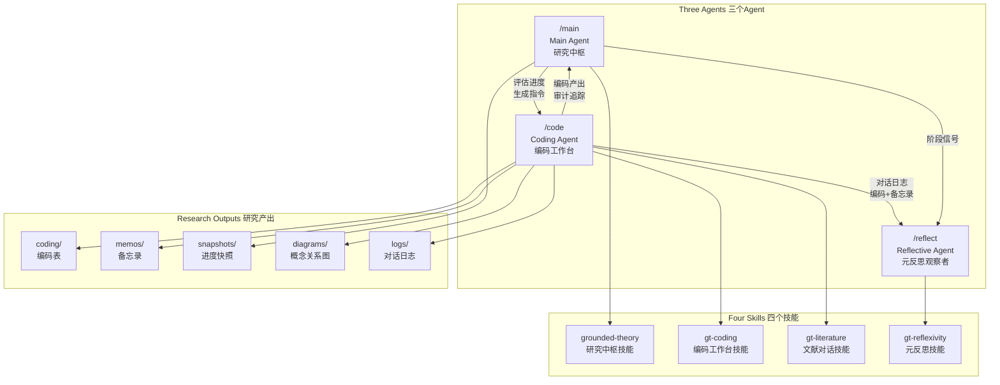

# Computational Grounded Theory Multi-Agent Toolkit

# 计算扎根理论多Agent协作工具包

A multi-agent collaboration system for Computational Grounded Theory (CGT) research, built on [Claude Code](https://docs.anthropic.com/en/docs/claude-code). Combines BERTopic topic modeling with Constructivist Grounded Theory (Charmaz 2006/2014) qualitative analysis through a structured three-agent workflow.

基于 [Claude Code](https://docs.anthropic.com/en/docs/claude-code) 的计算扎根理论（CGT）多Agent协作系统。将 BERTopic 主题建模与建构主义扎根理论（Charmaz 2006/2014）定性分析结合，通过结构化的三Agent工作流实现人机协作的质性研究。

---

## Architecture / 系统架构



### Agents / Agent 说明

| Agent | Command | Role | Description |
|-------|---------|------|-------------|
| **Main Agent** | `/main` | 研究中枢 | Methodology guardian. Evaluates research stage, checks methodological compliance, tracks saturation, generates snapshots with instructions for other agents. / 方法论守护者。评估研究阶段，检查方法论合规性，追踪饱和度，生成含指令的快照。 |
| **Coding Agent** | `/code` | 编码工作台 | Primary workhorse. Performs initial/focused/batch coding, literature dialogue, memo writing, and theory construction. / 核心执行者。执行初始/聚焦/批量编码、文献对话、备忘录撰写和理论建构。 |
| **Reflective Agent** | `/reflect` | 元反思观察者 | AI self-reflection. Reviews human-AI collaboration at stage transitions, produces autoethnographic memos examining Claude's own limitations and contributions. / AI自我反思。在阶段转换时回顾人机协作，生成审视Claude自身局限性和可能性的自传民族志风格备忘录。 |

### Skills / 技能说明

| Skill | Type | Description |
|-------|------|-------------|
| **grounded-theory** | Global | Core GT methodology: phase transitions, layered coding strategy, saturation checking, session management. / 核心GT方法论：阶段过渡、分层编码策略、饱和度检验、会话管理。 |
| **gt-coding** | Global | Coding operations: initial coding, focused coding, codebook convergence, batch coding, constant comparison, memo triggers. / 编码操作：初始编码、聚焦编码、框架收束、批量编码、持续比较、备忘录触发。 |
| **gt-literature** | Global | Literature dialogue: paper search → download → note creation → bidirectional data-literature dialogue, metaphor analysis. / 文献对话：论文搜索→下载→笔记创建→数据与文献双向对话、隐喻分析。 |
| **gt-reflexivity** | Global | AI reflexivity: five-dimension self-analysis framework, reflexive memo templates, longitudinal tracking. / AI反思：五维度自我分析框架、反思性备忘录模板、纵向追踪。 |
| **bertopic-guide** | Project | BERTopic optimization guide for memory-constrained machines (8GB RAM), Chinese text processing. / 内存受限机器（8GB RAM）上的BERTopic优化指南，中文文本处理。 |

---

## Installation / 安装

### Prerequisites / 前置条件

- [Claude Code](https://docs.anthropic.com/en/docs/claude-code) installed and configured
- (Optional) MCP servers for literature workflow:
  - `paper-search-mcp` — academic paper search
  - `mcp-obsidian` — Obsidian vault integration
  - `book-downloader` — book search and download

### Step 1: Install Global Skills / 安装全局技能

Copy the four skill directories to your Claude Code global skills folder:

```bash
# Clone this repo
git clone https://github.com/tangxy2001-sketch/computational-grounded-theory-multi-agent.git
cd computational-grounded-theory-multi-agent

# Copy skills to global location
cp -r skills/grounded-theory ~/.claude/skills/
cp -r skills/gt-coding ~/.claude/skills/
cp -r skills/gt-literature ~/.claude/skills/
cp -r skills/gt-reflexivity ~/.claude/skills/
```

### Step 2: Set Up Your Research Project / 设置研究项目

```bash
# Create your project directory
mkdir my-gt-research && cd my-gt-research

# Copy project-level files
cp -r /path/to/toolkit/.claude .claude/
cp /path/to/toolkit/template/CLAUDE.md CLAUDE.md

# Create the project directory structure
mkdir -p data/{raw,samples} coding/{initial,focused,categories} \
         memos/{coding,theoretical,process,literature,reflexivity} \
         literature diagrams snapshots logs
```

### Step 3: Configure CLAUDE.md / 配置项目协议

Edit `CLAUDE.md` in your project root to fill in:
- Your research questions (RQ1, RQ2, ...)
- Coding focus dimensions
- Theoretical dialogue directions
- Researcher profile

### Step 4: Configure Literature Workflow (Optional) / 配置文献工作流

If using Obsidian as your knowledge base, set your vault path in `~/.claude/CLAUDE.md` or your project `CLAUDE.md`:

```markdown
## Obsidian Vault
- Path: `/path/to/your/vault`
- Paper notes: `Papers/`
- PDF storage: `Resources/Papers/`
```

---

## Typical Workflow / 典型工作流

```
Session Start:
  /main          → Read latest snapshot, assess progress, generate work instructions

Core Work:
  /code          → Execute coding tasks per Main Agent's instructions
                    - Initial coding on selected topic clusters
                    - Literature dialogue when concepts emerge
                    - Memo writing (auto-triggered or manual)

Mid-session Check (optional):
  /main          → Methodology compliance check

Continue Work:
  /code          → Continue coding, save session log before ending

Stage Transition (when applicable):
  /reflect       → Generate reflexive memo reviewing AI participation

Session End:
  /main          → Generate progress snapshot for next session
```

---

## Project Structure / 项目结构

```
your-project/
├── CLAUDE.md               # Project protocol (from template/)
├── .claude/
│   ├── commands/            # Agent commands (/main, /code, /reflect)
│   └── skills/
│       └── bertopic-guide/  # BERTopic optimization guide
├── data/
│   ├── raw/                 # BERTopic results
│   └── samples/             # Sampled data for coding
├── coding/
│   ├── initial/             # Initial coding sheets (Excel)
│   ├── focused/             # Focused coding sheets
│   └── categories/          # Category tables
├── memos/
│   ├── coding/              # Coding memos (MEMO-IC-XXX)
│   ├── theoretical/         # Theoretical memos (MEMO-TC-XXX)
│   ├── process/             # Process memos (MEMO-PC-XXX)
│   ├── literature/          # Literature dialogue memos (MEMO-LIT-XXX)
│   └── reflexivity/         # Reflexive memos (REFLEX-XXX)
├── literature/              # Literature recommendation lists
├── diagrams/                # Concept maps (Mermaid/HTML)
├── snapshots/               # Research progress snapshots
├── logs/                    # Session dialogue logs
└── audit_trail.xlsx         # Analysis audit trail
```

---

## Methodology / 方法论基础

This toolkit implements a **Computational Grounded Theory** (Nelson 2020) approach:

1. **Layer 1 — Computational Discovery**: BERTopic topic modeling on large-scale text data
2. **Layer 2 — Deep Coding**: Human-AI collaborative qualitative coding (Charmaz CGT)
3. **Layer 2.5 — Framework Convergence**: Codebook drafting and cross-topic validation
4. **Layer 3 — Framework-Assisted Coding**: AI batch coding with human review
5. **Layer 4 — Theoretical Sampling**: Concept-driven data selection

The **Reflective Agent** adds a unique methodological layer: systematic AI self-reflection on its own participation in qualitative analysis, producing autoethnographic memos that serve as material for methodology papers.

---

## Key References / 核心参考文献

- Charmaz, K. (2014). *Constructing Grounded Theory* (2nd ed.). Sage.
- Nelson, L. K. (2020). Computational Grounded Theory: A Methodological Framework. *Sociological Methods & Research*, 49(1), 3-42.
- Lakoff, G., & Johnson, M. (1980). *Metaphors We Live By*. University of Chicago Press.

---

## License

MIT License. See [LICENSE](LICENSE).

---

## Contributors / 贡献者

- [Xinyi Tang (@tangxy2001-sketch)](https://github.com/tangxy2001-sketch)

---

## Citation / 引用

If you use this toolkit in your research, please cite:

```bibtex
@software{cgt_multi_agent_2026,
  title={Computational Grounded Theory Multi-Agent Toolkit},
  author={[Xinyi Tang]},
  year={2026},
  url={https://github.com/tangxy2001-sketch/computational-grounded-theory-multi-agent}
}
```
