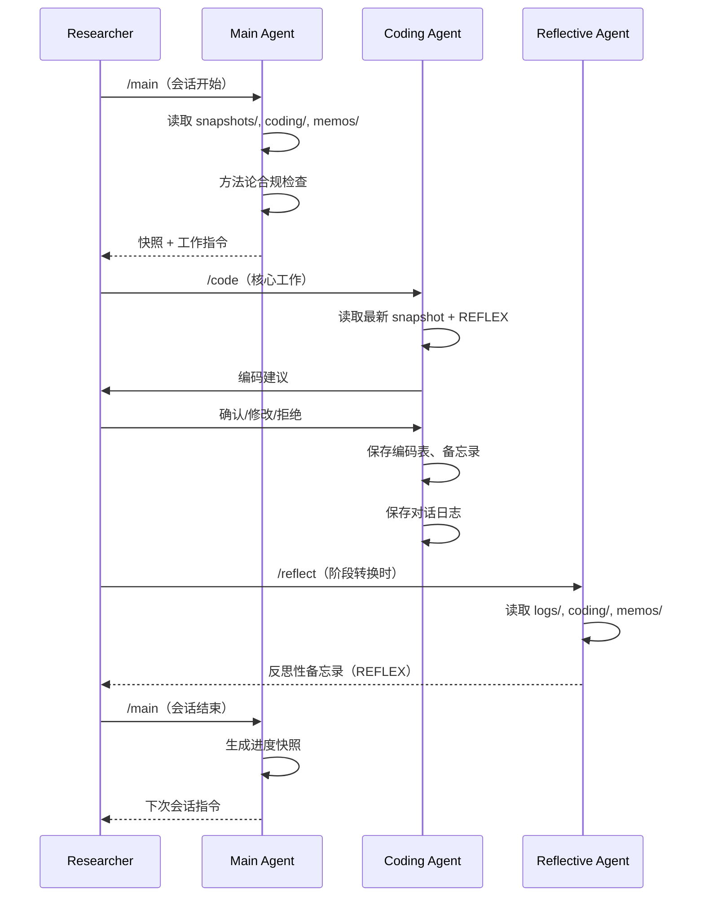
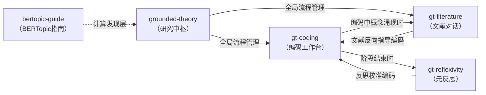
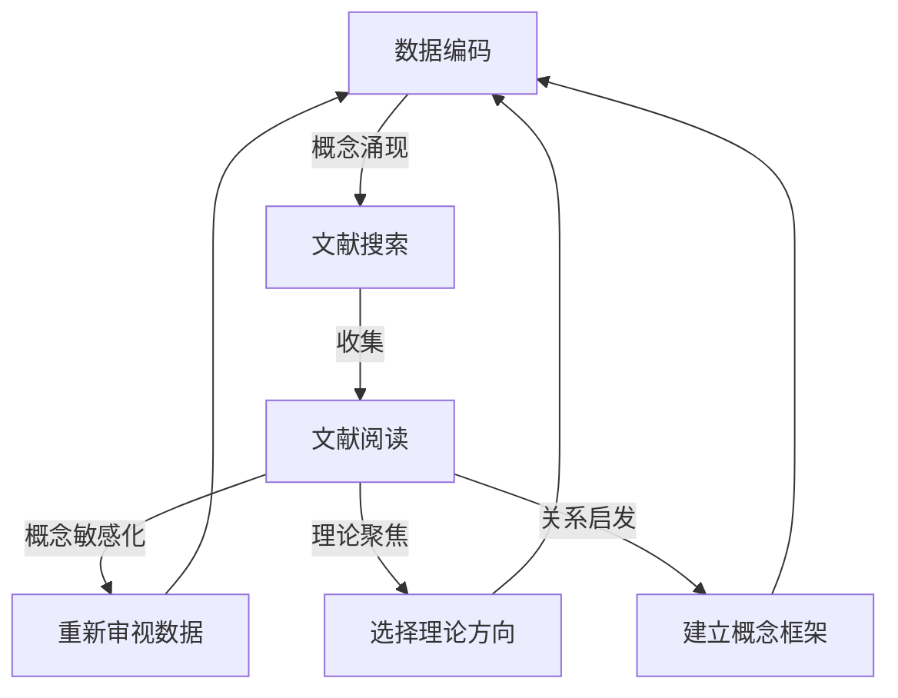

# 系统架构说明 / System Architecture

## Agent 协作协议

三个 Agent 通过文件系统进行异步交接，无需实时通信。每个 Agent 有明确的职责边界和输入/输出规范。

### 协作数据流



### 交接文件

| 交接方向 | 媒介文件 | 内容 |
|----------|----------|------|
| Main → Coding | `snapshots/snapshot_*.md` | 工作指令、阶段状态 |
| Coding → Main | `audit_trail.xlsx`, `coding/`, `memos/` | 编码产出、审计记录 |
| Coding → Reflective | `logs/session_*.md`, `coding/`, `memos/` | 对话日志、编码表、备忘录 |
| Reflective → Coding | `memos/reflexivity/REFLEX-*.md` | 反思备忘录（Coding Agent 下次会话开始时读取） |
| Main → Reflective | `snapshots/` | 阶段判断信号 |

## Skill 之间的依赖关系



**依赖说明：**

- `grounded-theory` 是元技能，管理全局流程。其他技能从它获取阶段判断
- `gt-coding` 和 `gt-literature` 互相调用：编码涌现概念 → 搜索文献；文献指导 → 回到编码
- `gt-reflexivity` 在阶段转换时被触发，其产出被下一轮 `gt-coding` 读取
- `bertopic-guide` 是独立的项目级技能，在计算发现层使用

## 分层编码策略

```
┌─────────────────────────────────────────────────┐
│  Layer 1: Computational Discovery               │
│  BERTopic 主题建模 → 3000+ 主题簇               │
│  （bertopic-guide skill）                        │
├─────────────────────────────────────────────────┤
│  Layer 2: Deep Coding                            │
│  研究者 + Claude 逐段细读、初始编码              │
│  （gt-coding skill, Coding Agent）               │
├─────────────────────────────────────────────────┤
│  Layer 2.5: Framework Convergence                │
│  编码手册草稿、跨主题验证                        │
│  （gt-coding skill）                             │
├─────────────────────────────────────────────────┤
│  Layer 3: Framework-Assisted Coding              │
│  Claude 用已建框架批量编码，研究者审核            │
│  （gt-coding skill, Coding Agent）               │
├─────────────────────────────────────────────────┤
│  Layer 4: Theoretical Sampling                   │
│  根据涌现概念回到数据                            │
│  （grounded-theory skill, Main Agent）           │
└─────────────────────────────────────────────────┘
```

## 反思机制

Reflective Agent 的反思维度：

| 维度 | 核心问题 |
|------|----------|
| 认识论能力与盲区 | 我"理解"了什么，遗漏了什么？ |
| 被质疑与被纠正 | 研究者在哪里否定了我？ |
| 意外的贡献 | 我在哪里带来了价值？ |
| 表述权力 | 我的语言是否在主导分析？ |
| 与人类的根本差异 | 我做不到什么？ |

反思备忘录的纵向追踪通过每份备忘录末尾的「自我诊断快照」实现，记录被质疑频率、最突出局限、最有价值贡献、角色隐喻等指标，用于跨阶段对比。

## 文献对话的双向迭代



文献对话是双向的：
1. **数据 → 文献**：编码中涌现的概念驱动文献搜索
2. **文献 → 数据**：文献提供新的"提问角度"，带回数据重新审视
